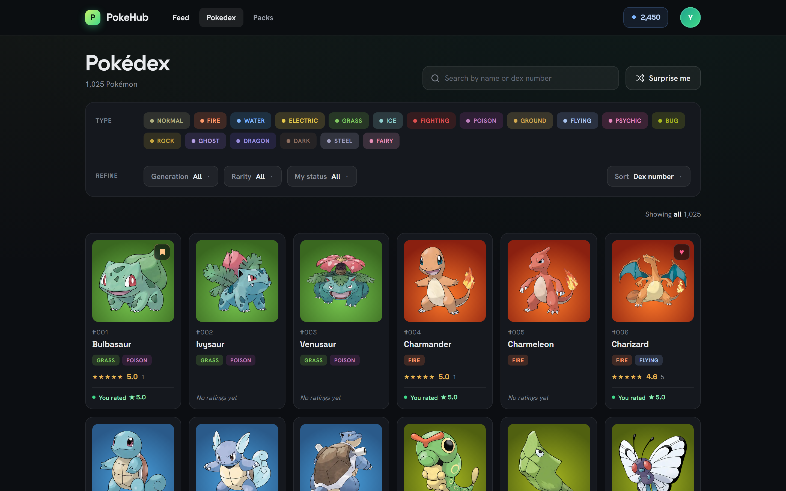
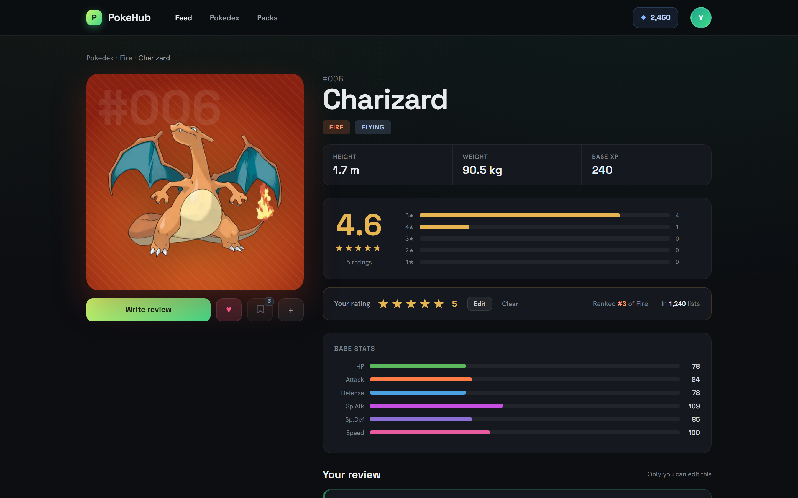
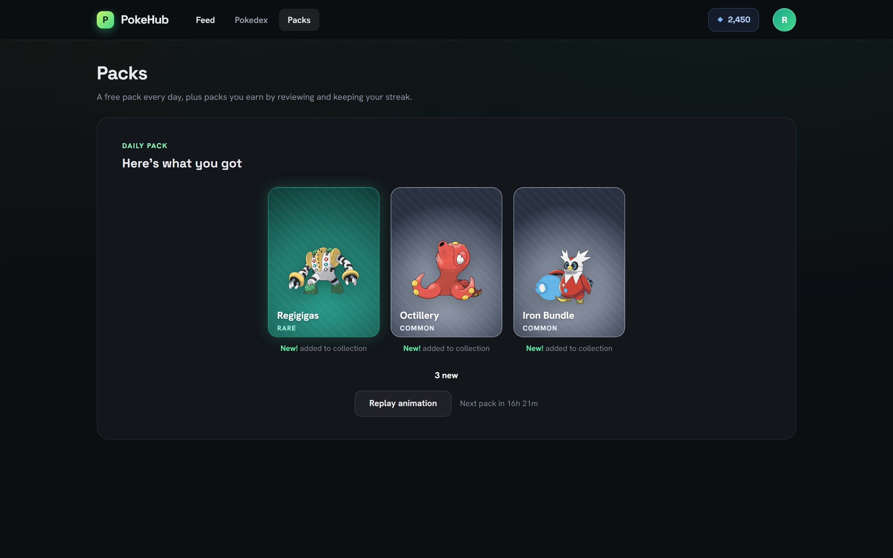
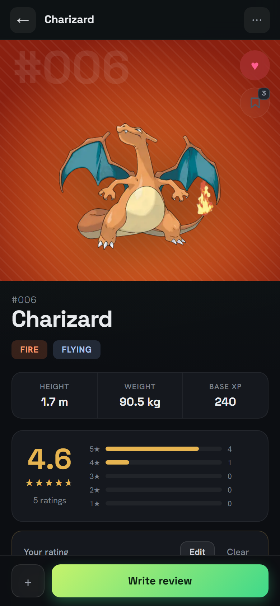

# PokeHub

A social app for Pokémon fans: rate and review all 1,025 species, and open a free pack of three every day to build a collection.

**Live demo:** https://pokehub-sigma.vercel.app/

## Screenshots

**Pokédex** with type, generation, rarity and status filters



**Pokémon page** with the community rating, your rating and base stats



**Daily pack** after the reveal



**Mobile** layout of the Pokémon page



## Features

- **Pokédex**: browse all 1,025 Pokémon with search (name or dex number), filters for type, generation, rarity and your own status (rated, favorites, wishlist), and sorting by dex number, name, highest rated or most rated. Filters live in the URL, so any view can be shared.
- **Pokémon pages**: artwork, types, physical data, base stats and a community rating with its distribution.
- **Ratings and reviews**: rate from 0.5 to 5 stars in half steps, write, edit or delete a review, and read all reviews sorted by newest, highest or lowest rating.
- **Favorites and wishlist**: favorite any number of Pokémon and wishlist up to 3, from the Pokémon page or, on desktop, straight from the Pokédex grid.
- **Daily pack**: one free pack per UTC day with three Pokémon rolled by rarity tier (Common 70%, Uncommon 20%, Rare 9%, Ultra rare 1%) and a 0.5% shiny chance per slot, revealed one by one. Pulls go into your collection and duplicates are counted.
- **Profiles**: `/u/[username]` with a header, bio and your latest reviews.
- **Accounts**: sign up with email and password or GitHub, then pick a username.
- Responsive layouts for desktop and mobile.

## Tech stack

| Area | Tools |
|---|---|
| Frontend | Next.js 16 (App Router), React 19, TypeScript, Tailwind CSS v4, shadcn/ui (Base UI), Zustand, Sonner |
| Backend & data | Server Actions, Prisma 7, Neon Postgres, Zod, PokeAPI (seed only) |
| Auth | Auth.js (NextAuth v5) with Credentials and GitHub providers, bcrypt |
| Tooling & deploy | ESLint, tsx scripts, Vercel |

## Architecture and key decisions

- **Server Components by default.** Pages read Prisma directly, with no API layer in between. Client components are limited to interactive pieces (rating stars, toggles, the review composer, the pack stage).
- **Server Actions for mutations, logic in `src/lib/`.** Each action in `src/actions/` checks the session, validates input with Zod, calls a plain domain function and revalidates the affected paths. Keeping the logic out of the action makes it reusable if a REST API is ever needed (for example, a mobile client). Route handlers are used only for the auth flows and the random-Pokémon redirect.
- **Optimistic UI with Zustand for shared client state.** Rating, favorite and wishlist toggles update immediately and roll back with a toast if the action fails. Zustand holds the state that several components need at once: the auth modal, the review composer, and the wishlist count that enforces the 3-slot cap across the page.
- **Auth.js with JWT sessions.** The Credentials provider only works with JWT sessions, so the whole app uses them. `src/proxy.ts` is the single place that enforces "signed in users must have a username": it redirects page requests and returns a 403 to Server Action calls.
- **Prisma + Neon, Pokémon data seeded once.** A script loads all species from PokeAPI into Postgres, so the app never calls PokeAPI at runtime. Images are linked from the PokeAPI sprites repository rather than re-hosted.
- **Concurrency-safe daily pack.** Opening the pack runs in one transaction that starts by claiming the UTC day with a conditional update on `lastDailyAt`, then writes the pack, its rolls and the collection changes. A second request (another tab, a double click) waits on the row lock and then finds the day already claimed, so it can't open two packs.

## Data model

- **Pokemon**: reference data seeded from PokeAPI. The dex number is the primary key, and rarity is derived from legendary/mythical flags plus a curated list.
- **User**: the account, profile fields and `lastDailyAt` for the daily pack. Auth.js uses `Account` and `VerificationToken` next to it.
- **UserPokemon**: one row per user and Pokémon. It holds the rating, review text, favorite and wishlist flags, and collection state (caught, count, shiny count), so a profile or Pokédex read needs a single join. Ratings are stored as integer half-star units (1–10), so averages and `GROUP BY` stay exact.
- **Pack → PackRoll**: an opened pack and its three slots. Each roll stores the rarity at the time of the pull, so rebalancing tiers later doesn't rewrite history.
- The schema also contains models for upcoming features: lists, comments, likes, follows, feed events and a dust ledger (`DustTransaction`). They aren't used by the app yet, and neither are the pity counters and dust balance on `User`.

## Getting started

Requirements: Node.js 20.9+, a [Neon](https://neon.tech) Postgres database (the app connects through Prisma's Neon adapter), a `RESEND_API_KEY` value (the Resend client needs one at startup, but a placeholder is fine because email delivery isn't finished), and optionally a GitHub OAuth app.

1. Install dependencies (this also generates the Prisma client):

   ```bash
   npm install
   ```

2. Copy `.env.example` to `.env` and fill in the values.

3. Apply the migrations:

   ```bash
   npm run db:migrate:deploy
   ```

4. Seed the Pokémon table from PokeAPI (takes a few minutes):

   ```bash
   npx prisma db seed
   ```

5. Start the dev server and open http://localhost:3000:

   ```bash
   npm run dev
   ```

`.env.example` sets `REQUIRE_EMAIL_VERIFICATION="false"`, so new accounts can sign in without confirming their email. Keep it that way until email delivery is finished. With `DEV_UNLOCK_ALL="true"` you can open the daily pack more than once a day (ignored in production).

## Roadmap

**Collection (packs)**
- Pity: a guaranteed Rare after 20 packs without one and a guaranteed Ultra rare after 50
- Wishlist boost: ×1.5 weight for your wishlisted Pokémon in your own packs
- Dust and duplicates: dissolve extra copies into dust, with every change written to a ledger
- Earned packs from activity (5 per day cap), a dust shop and 7-day streak bonuses
- Pack history and feed events for rare and shiny pulls

**Social**
- Ranked and unranked lists
- Follows, likes and comments on reviews and lists
- Activity feed, discovery page and unified search
- Settings for wishlist, signature team and profile, avatar upload

**Platform**
- Email delivery via Resend for email verification and password reset (the flows are built, sending isn't finished yet)
- Google OAuth and magic-link sign-in
- Cosmetic-only Pro subscription via Stripe
- Scheduled jobs for daily resets, streaks, a weekly digest and feed pruning

**Later**
- Trading, a mobile app, themed event packs, notifications, moderation tools and Polish localization

## Disclaimer

Pokémon and all related names and images are trademarks of Nintendo, Game Freak and The Pokémon Company. PokeHub is a non-commercial portfolio project. Pokémon data comes from [PokeAPI](https://pokeapi.co).
